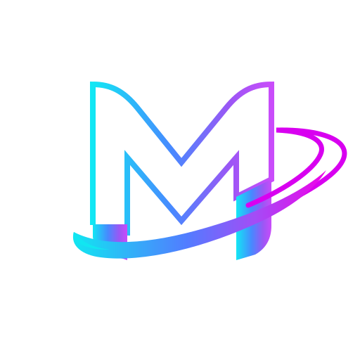

<!-- HEADER -->

  

<h1 align="center">MOAZZAM MATIN</h1>

  MLOps Engineer | Machine Learning | Python Developer Tools

---

## TECHNOLOGIES & TOOLS

  
  
  
  
  
  
  
  
  
  
  
  
  
  

## ABOUT ME

I'm an MLOps Engineer focused on building reliable machine learning systems and developer tools.

I enjoy turning machine learning concepts into practical engineering solutions, with an emphasis on experiment tracking, reproducibility, model evaluation, and maintainable workflows.

I learn by building real projects, testing ideas, and continuously improving my engineering skills.

## PROJECTS

### [maarg](https://github.com/Moazzam-Matin/maarg)

A lightweight, local-first Python experiment tracking library designed to track experiments with zero boilerplate.

### [Recommendation Engine](https://github.com/Moazzam-Matin/recommendation-engine)

A recommendation system project exploring collaborative filtering, model evaluation, and experiment tracking with MLflow.

### [Personal Portfolio](https://github.com/Moazzam-Matin/portfolio)

My personal website showcasing my technical interests, engineering work, and open-source contributions.

## CONNECT WITH ME

